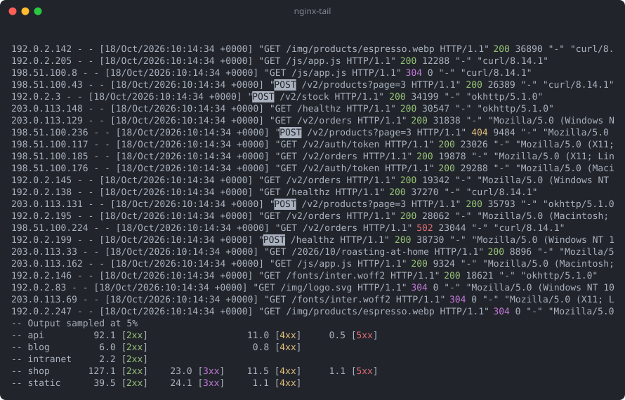

# nginx-tail, better than `tail -f`

## About this project

A tool to keep an eye on `nginx` access logs, especially on busy servers (1000+
requests per second).

This is a personal project. I'm not likely to accept PRs; I do welcome bug
report, ideas and feature requests.

## Screenshots



Regenerate it with `./make_screenshot.py` (needs `tmux`).

## Quickstart

Input selection:

```shell
  # tails all access.log files found in /var/log/nginx:
  $ nginx-tail

  # tails all access.log files in subfolder (recursive):
  $ nginx-tail /var/log/nginx/subfolder

  # only tail mysite.log:
  $ nginx-tail /var/log/nginx/mysite.log
```

Filtering:

```shell
  # only show 404 + all 5xx lines:
  $ nginx-tail --include 404 --include 5xx
```

Output modes:

```shell
  # runs as a terminal UI where you see live stats + can scroll back to read lines
  $ nginx-tail

  # does not render UI but does apply filtering and syntax highlighting:
  $ nginx-tail | less -R
```

Lots of log files:

```shell
  # by default the stats use at most half of the screen. When there are more
  # files than fit, the most active ones are shown, followed by "... and X more"
  $ nginx-tail

  # use at most 10 rows for the stats instead:
  $ nginx-tail --file-rows 10
```

## Design

It should do "the right thing" without configuration. A user should have a good
time using this tool without having to dig into the command line options. This
often means the tool automatically toggles behavior on/off by itself based on
the circumstances, with the option to force a state through command line flags.

Threadless async: the workload is perfect for async and we don't need the
overhead of threads. Blocking IO will be done in separate threads until we can
master io_uring.

Performant: it should be reasonably fast. It will be used during debugging
sessions and we don't want to add fuel to a potential fire.

Minimal set of dependencies. If we can easily build something ourselves we
should. This is educational and reduces supply chain risks. The software only
needs to run on a specific set of servers so we don't need to overly target
cross compatibility. Releases are built with `musl` to improve portability but
that's it.
